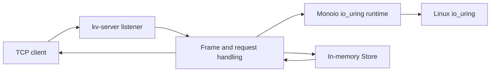
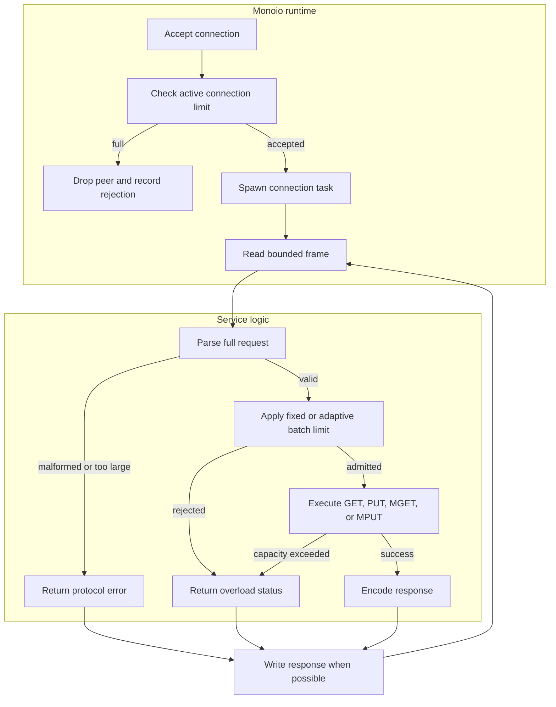

# io_uring key-value server

## Contents

- [Architecture and execution guide](#architecture-and-execution-guide)
- [Design](#design)
- [Measured results](#measured-results)
- [Verify](#verify)
- [Upstream README and licenses](README.upstream.md)

## Architecture and execution guide

This repository preserves Monoio and adds a bounded [loopback](#loopback-bind) key-value service in `kv-server/`. Monoio supplies the async runtime, TCP primitives, and native [io_uring](#io-uring) driver. The service owns its binary protocol, in-memory map, [atomic batches](#atomic-batch), and [admission control](#admission-control). It has no disk persistence and no epoll fallback.

The diagram separates the service from its inherited runtime.



A connection reads bounded frames and parses a complete operation. The store validates lengths, trailing bytes, batch count, and admission before mutation. MPUT stages entries and checks aggregate capacity before insertion, so a rejected batch cannot partially update the map. One runtime thread owns the `Rc<RefCell<Store>>`; tasks yield around network I/O, while each map operation runs synchronously.



| Subsystem | Responsibility and owned invariant | Source |
| --- | --- | --- |
| Runtime setup | Require a numeric loopback address and native `IoUringDriver` | [`main.rs`](kv-server/src/main.rs) |
| Protocol and store | Parse complete requests; keep byte accounting consistent; stage MPUT before mutation | [`lib.rs`](kv-server/src/lib.rs) |
| Connection and admission | Bound frames, connections, pending responses, and adaptive policy state | [`main.rs`](kv-server/src/main.rs) |
| Verification | Exercise protocol, atomic history, malformed input, and capacity recovery | [`verify.py`](kv-server/scripts/verify.py) |
| Async runtime | Own scheduling and native io_uring operations inherited from upstream | [`monoio/`](monoio/) |

### Follow a request

1. The server validates its arguments and starts the Linux io_uring runtime. Setup failure exits with an error; another operating system exits explicitly.
2. The listener accepts a TCP peer and applies the current connection limit. A full limit drops the connection.
3. The task reads a frame capped at 1 MiB, then decodes its operation and fields. Malformed or trailing bytes return an error without changing the map.
4. MGET parses all keys before reading. MPUT parses and stages every pair, checks admission and store capacity, then applies all entries.
5. The server writes the response. Connection completion decrements the active count; adaptive admission samples rejections in windows.

<a id="loopback-bind"></a>
<details><summary>What is loopback binding?</summary>

Loopback binding restricts a socket to the local machine. The parser accepts literal `127.0.0.1` or `::1` addresses and rejects `0.0.0.0` and hostnames.
</details>

<a id="frame"></a>
<details><summary>What is a frame?</summary>

A frame is one length-delimited request on the TCP stream. This server caps it at 1 MiB and rejects malformed or trailing bytes before execution.
</details>

<a id="atomic-batch"></a>
<details><summary>What is an atomic batch?</summary>

An atomic batch either changes every requested key or changes none. MPUT stages entries and verifies store bounds before inserting a value.
</details>

<a id="admission-control"></a>
<details><summary>What is admission control?</summary>

Admission control limits work before it consumes more service capacity. This server bounds connections and, in adaptive mode, batch size using pending-response occupancy and recent rejections.
</details>

<a id="io-uring"></a>
<details><summary>What is io_uring?</summary>

io_uring is the Linux kernel interface used by Monoio's native driver for asynchronous I/O. This binary reports setup failure instead of switching to another backend.
</details>

### Design choices and limits

The rationale is inferred from current code, not recorded historical intent.

| Choice | Current behavior and rationale | Alternative and cost to reconsider |
| --- | --- | --- |
| One runtime thread owns the map | Each store operation has a clear serialization point. | Sharding may scale work but adds synchronization and cross-shard batch semantics. |
| Validate and stage MPUT | Malformed or over-capacity batches cannot leave partial updates. | Incremental mutation uses less temporary memory but needs rollback or weaker atomicity. |
| Loopback-only service | Keeps this unauthenticated demo local. | Remote access needs authentication and transport security, not just a wider bind address. |
| Native io_uring without fallback | Makes the required execution path explicit. | A portable driver broadens hosts but changes the verified runtime path. |
| Bounded adaptive limits | Policy stays within configured connection and batch maxima. | Request combining adds queueing and scheduling behavior not present here. |

A bounded Rust TCP key-value service running on Monoio's native Linux io_uring driver. It implements atomic batched writes, snapshot reads, admission control, a concurrent-history checker and an offered-load benchmark.

This repository preserves the complete [Monoio](https://github.com/bytedance/monoio) runtime and its history at `8675e9406ea7943c441d969e38c3f5fc198ef6d1`. The service and verification tooling are additions in [`kv-server/`](kv-server/). The [original README](README.upstream.md) and MIT/Apache-2.0 notices are retained.

## Run

Use Rust 1.99.1 and Python 3 on Linux with io_uring permitted by the kernel and process policy:

```sh
cargo build --locked --release -p monoio-kv-server
target/release/monoio-kv-server --bind 127.0.0.1:9000 --batch-mode adaptive
```

The server accepts only numeric loopback addresses. It constructs `RuntimeBuilder<IoUringDriver>` directly and reports the actual driver on startup. It exits explicitly on unsupported hosts or denied io_uring setup. Storage is in memory and is lost when the process stops.

## Design

All storage operations execute on one local runtime thread. A request parses and validates its entire payload before admission, then changes or snapshots the map without an await. MPUT stages all changes before mutation; MGET observes one state. Separate connection tasks yield at network I/O.

The binary protocol supports GET, PUT, MGET and MPUT. Frames are capped at 1 MiB, keys at 1 KiB, values at 16 KiB and batches at 32 items. Stored key/value bytes are limited to 64 MiB and 100,000 keys; concurrent connections are capped at 64. See the [protocol and controller details](kv-server/README.md).

Fixed mode uses configured connection and request-size limits. Adaptive mode adjusts connection admission after windows of accepted/rejected connections and bounds accepted batch size using pending response occupancy. This is a small admission policy inspired by [SEDA](https://www.sosp.org/2001/papers/welsh.pdf); it does not dynamically combine requests or reproduce SEDA's full staged architecture.

## Measured results

The [full native Linux campaign](https://github.com/STEVVVU/io-uring-kv-server/actions/runs/39730624965) completed 186 trials on four-vCPU AMD EPYC 7763 runners, with exact response checks, no client failures/timeouts, and successful cleanup. At 48 persistent clients, the highest tested rates that completed every offer in all five ten-second repeats were:

| Value size | Fixed offers/s | Adaptive offers/s | Fixed / adaptive p99 end-to-end ms, median [min, max] |
|---|---:|---:|---|
| 64 B | 50,000 | 10,000 | 1.606 [1.606, 1.638] / 1.343 [1.343, 1.343] |
| 1 KiB | 20,000 | 5,000 | 1.573 [1.540, 1.606] / 1.278 [1.278, 1.311] |
| 16 KiB | 8,000 | 8,000 | 2.949 [2.753, 3.539] / 2.949 [2.753, 3.277] |

These are tested lower bounds, not proven capacity maxima. The p99 includes offer scheduling, client generation/queueing and response validation; histogram upper edges have at most 3.125% bucket width. The lower adaptive rates above are different workloads, so this table establishes no latency speedup. At the highest rates adaptive rejected 568 small requests and one 1 KiB request; eight-client cells also exposed generator drops. All losses remain in the [full matrix, resources, environment and raw hashes](docs/benchmarks/linux-39730624965/README.md).

Both policies completed every offer in separate 120-second runs at 2,000/s for 64 B, 1,000/s for 1 KiB and 500/s for 16 KiB. The campaign exposed and fixed an adaptive admission bug: idle connections were counted as pending responses and rejected valid MGET16 requests. A native 48-idle-peer regression now covers it. Adaptive admission still trades accepted work for rejection under load. [Reproduce the frozen campaign](kv-server/BENCHMARK.md).

## Verify

```sh
cargo fmt --all -- --check
cargo test --locked -p monoio-kv-server
cargo clippy --locked --no-deps -p monoio-kv-server --all-targets -- -D warnings
python3 kv-server/scripts/doctor.py --binary target/release/monoio-kv-server --evidence reports/evidence
python3 kv-server/scripts/verify.py --binary target/release/monoio-kv-server --evidence reports/evidence
python3 kv-server/scripts/benchmark.py --binary target/release/monoio-kv-server --evidence reports/evidence
```

The real-product driver checks exact GET/PUT values, atomic batched histories, fragmented network I/O, malformed requests, storage limits and connection-capacity recovery. It records owned process IDs, cleanup results and a durable failing verdict when an assertion fails. The [verification skill](.agents/skills/verify/SKILL.md) maps the lifecycle and negative control.

The benchmark interleaves fixed/adaptive runs using the same seeded operation stream, bounded client queue and Poisson arrivals. It retains raw latency samples and reports offered, attempted, completed, rejected, timed-out and failed counts separately. Wire latency, client queue delay and offer-to-completion latency are separate measurements.

The [initial native Ubuntu run](https://github.com/STEVVVU/io-uring-kv-server/actions/runs/39713710063) passed portable tests, Clippy, native io_uring startup, real protocol/concurrent-history/capacity checks and deliberate-failure cleanup. Its [historical evidence](docs/evidence/linux-39713710063/) remains available; use the larger campaign above for current results. No university grading SLO, multicore scaling, persistence or general latency advantage is claimed. This is an independently scoped service informed by the [Brown CSCI 1675 systems topic](https://cs.brown.edu/courses/csci1675/fall2025/hw/project-2.html), without course starter code or grader compatibility.

The active GitHub workflows run read-only native Linux verification and the manual load campaign, retaining evidence. Inherited runtime automation is preserved in [`.github/upstream-workflows/`](.github/upstream-workflows/).
