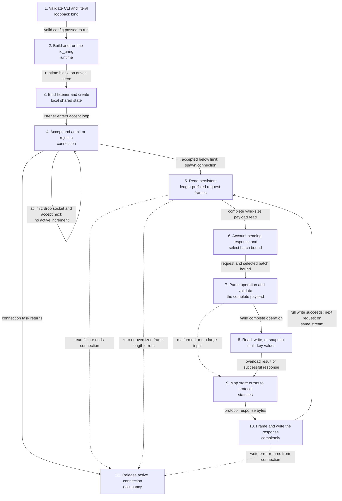
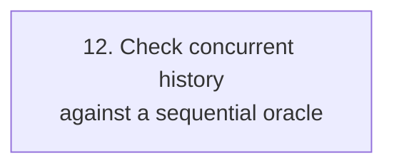
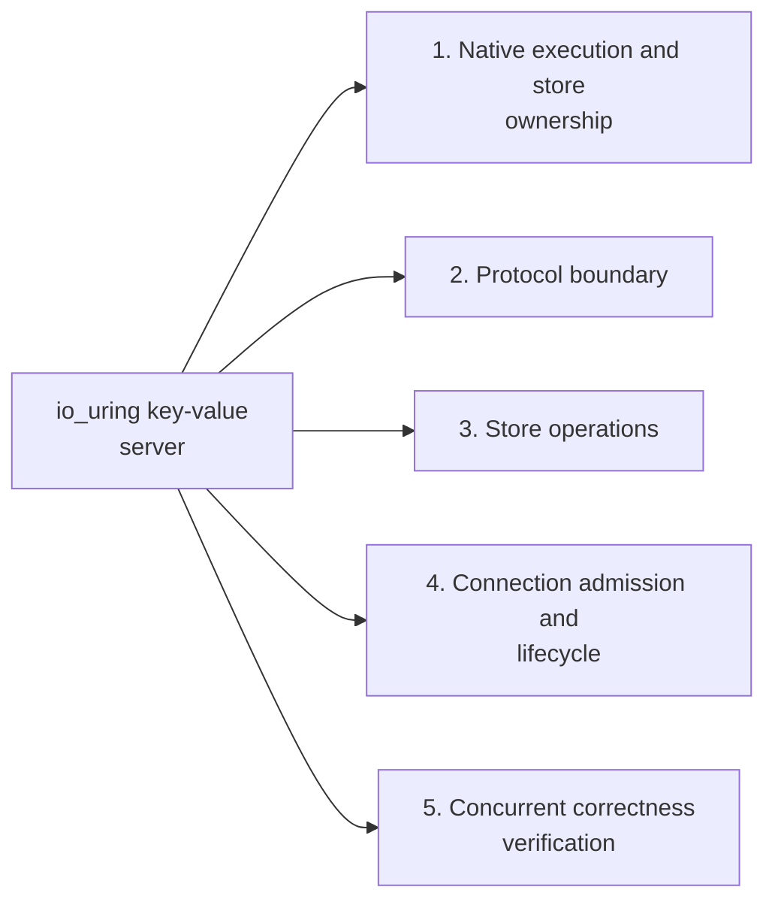
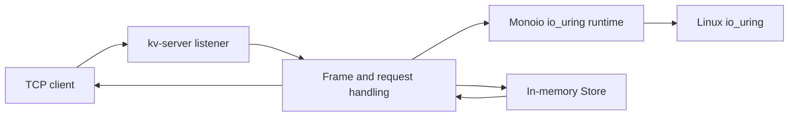
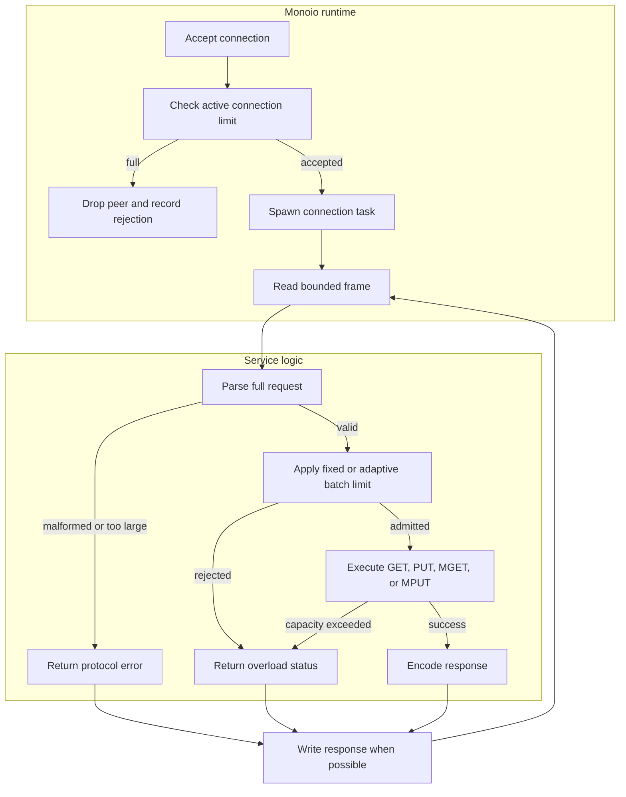

# io_uring key-value server

## Contents

- [Implementation techniques](#implementation-techniques)
- [Architecture and execution guide](#architecture-and-execution-guide)
- [Design](#design)
- [Measured results](#measured-results)
- [Verify](#verify)
- [Upstream README and licenses](README.upstream.md)

## Architecture and execution guide

<!-- execution-flow:start -->
### Execution flow

Start with the primary path, then expand a detailed workflow. Select a numbered node to see its operation, implementation techniques, and source. Solid arrows show the named control, data, or lifecycle handoff; dotted arrows show error paths. Separate entry points are named in each workflow.

<a id="review-walkthrough"></a>

#### Walk through one concrete example

A client connects to the configured loopback server and sends one length-prefixed request that reads two keys from the store.

**Trace.** [Bind listener and create local shared state](#flow-step-listener-state) → [Accept and admit or reject a connection](#flow-step-accept-admit) → [Read persistent length-prefixed request frames](#flow-step-persistent-read-frame) → [Account pending response and select batch bound](#flow-step-account-batch-limit) → [Parse operation and validate the complete payload](#flow-step-parse-validate) → [Read, write, or snapshot multi-key values](#flow-step-store-dispatch) → [Map store errors to protocol statuses](#flow-step-map-errors) → [Frame and write the response completely](#flow-step-write-response).

**Result and boundary.** The server validates the complete request, dispatches the multi-key read, and writes a framed response before reading the next frame on the persistent connection. Admission is bounded; when at its socket limit, an accepted socket is dropped without decrementing active occupancy, then the accept loop continues.

<details>
<summary>Implementation decisions to explain</summary>

**Why validate the complete payload before calling the store?** Parsing and validation establish the operation and all operands before dispatch, avoiding partial effects from malformed requests. This delays store work until the full frame is checked.

[Bounded full-input validation](#technique-full-validation).

**Why keep the connection open after a response?** The protocol reads another length-prefixed frame from the same connection, avoiding a reconnect per request. The client must still respect framing and connection lifecycle.

[Persistent connection request lifecycle](#technique-persistent-connection).

</details>

#### Primary execution flow

Linux CLI startup selects the literal loopback socket and native io_uring runtime, then serve admits connections into a single-owner local state machine. Each persistent connection reads framed requests, validates and executes them, maps errors, writes framed responses, and releases occupancy; the history oracle is an independent verification workflow.



**Detailed workflows.** [Native server request lifecycle](#flow-workflow-server-request-lifecycle) · [Concurrent history oracle](#flow-workflow-history-oracle).

<a id="flow-workflow-server-request-lifecycle"></a>

<details>
<summary>Native server request lifecycle</summary>

Starts from Linux CLI parsing and follows the real io_uring service through admission, request parsing, store operations, response framing, and task cleanup. Rejected sockets are dropped in serve without spawning a connection task; malformed frames and read/write failures terminate their connection.


</details>

<a id="flow-workflow-history-oracle"></a>

<details>
<summary>Concurrent history oracle</summary>

Independent verification-only path: verify.py gathers operation intervals and observed results from real TCP sessions, then linearizable checks whether some sequential order respects real-time precedence and the MPUT/MGET map specification. The checker self-test includes a fractured snapshot that must be rejected; it does not run in the service request path.



</details>

#### Steps, techniques, and source

These source traces cover the active scope below. They explain implementation behavior; benchmark results and their limits remain in the measurement sections.

<a id="flow-step-cli-config"></a>

##### 1. Validate CLI and literal loopback bind

**Component.** kv-server::Config::from_args. Parses bind, connection, and batch options; bind values must parse as numeric socket addresses on a loopback interface. Invalid, missing, unknown, or out-of-range options return errors.

**Techniques at this step.** [Literal loopback binding](#technique-loopback).

**Source.** [`kv-server/src/main.rs:43`](https://github.com/STEVVVU/io-uring-kv-server/blob/master/kv-server/src/main.rs#L43) · [`kv-server/src/lib.rs:15`](https://github.com/STEVVVU/io-uring-kv-server/blob/master/kv-server/src/lib.rs#L15). [Back to execution flow](#execution-flow).

<a id="flow-step-native-runtime"></a>

##### 2. Build and run the io_uring runtime

**Component.** kv-server::run / monoio::Runtime::block_on. The Linux entrypoint constructs RuntimeBuilder<IoUringDriver> and drives serve. The runtime polls its future and local task queue, submits when tasks remain, then parks to process completion events; startup errors reach main and exit nonzero.

**Techniques at this step.** [Completion-based asynchronous I/O](#technique-completion-io).

**Source.** [`kv-server/src/main.rs:16`](https://github.com/STEVVVU/io-uring-kv-server/blob/master/kv-server/src/main.rs#L16) · [`monoio/src/runtime.rs:131`](https://github.com/STEVVVU/io-uring-kv-server/blob/master/monoio/src/runtime.rs#L131) · [`monoio/src/driver/uring/mod.rs:358`](https://github.com/STEVVVU/io-uring-kv-server/blob/master/monoio/src/driver/uring/mod.rs#L358). [Back to execution flow](#execution-flow).

<a id="flow-step-listener-state"></a>

##### 3. Bind listener and create local shared state

**Component.** kv-server::serve. Binds the configured listener and initializes local active-count, pending-response-count, Store, and Admission state using Rc/Cell/RefCell. It prints and flushes READY only after setup succeeds.

**Techniques at this step.** [Single-owner asynchronous execution](#technique-single-owner) · [Bounded connections and pending-response accounting](#technique-bounded-admission).

**Source.** [`kv-server/src/main.rs:145`](https://github.com/STEVVVU/io-uring-kv-server/blob/master/kv-server/src/main.rs#L145). [Back to execution flow](#execution-flow).

<a id="flow-step-accept-admit"></a>

##### 4. Accept and admit or reject a connection

**Component.** kv-server::serve. Each accepted socket is compared with the current connection limit and contributes to a 32-attempt sample. At or above the limit it drops the socket; otherwise it increments active count and spawns a connection task sharing the same local store and counters.

**Techniques at this step.** [Bounded connections and pending-response accounting](#technique-bounded-admission) · [Windowed adaptive limits with hysteresis](#technique-adaptive-limits) · [Persistent connection request lifecycle](#technique-persistent-connection) · [Single-owner asynchronous execution](#technique-single-owner).

**Source.** [`kv-server/src/main.rs:169`](https://github.com/STEVVVU/io-uring-kv-server/blob/master/kv-server/src/main.rs#L169). [Back to execution flow](#execution-flow).

<a id="flow-step-persistent-read-frame"></a>

##### 5. Read persistent length-prefixed request frames

**Component.** kv-server::connection / AsyncReadRentExt::read_exact. A connection loops reading a four-byte big-endian length and then exactly that many request bytes. Header or payload read errors end the connection cleanly; zero or over-limit lengths return InvalidData. read_exact repeats reads until filled, EOF, or another error.

**Techniques at this step.** [Length-prefixed TCP framing](#technique-length-framing) · [Persistent connection request lifecycle](#technique-persistent-connection) · [Completion-based asynchronous I/O](#technique-completion-io).

**Source.** [`kv-server/src/main.rs:244`](https://github.com/STEVVVU/io-uring-kv-server/blob/master/kv-server/src/main.rs#L244) · [`monoio/src/io/async_read_rent_ext.rs:84`](https://github.com/STEVVVU/io-uring-kv-server/blob/master/monoio/src/io/async_read_rent_ext.rs#L84). [Back to execution flow](#execution-flow).

<a id="flow-step-account-batch-limit"></a>

##### 6. Account pending response and select batch bound

**Component.** kv-server::PendingResponse / Admission::batch_limit. Once a full frame arrives, an RAII guard increments pending response work. The current fixed or queue-derived adaptive batch limit is read from Admission and passed to Store::execute; dropping the guard decrements the count on all exits.

**Techniques at this step.** [Bounded connections and pending-response accounting](#technique-bounded-admission) · [Windowed adaptive limits with hysteresis](#technique-adaptive-limits).

**Source.** [`kv-server/src/main.rs:201`](https://github.com/STEVVVU/io-uring-kv-server/blob/master/kv-server/src/main.rs#L201) · [`kv-server/src/main.rs:208`](https://github.com/STEVVVU/io-uring-kv-server/blob/master/kv-server/src/main.rs#L208) · [`kv-server/src/main.rs:107`](https://github.com/STEVVVU/io-uring-kv-server/blob/master/kv-server/src/main.rs#L107). [Back to execution flow](#execution-flow).

<a id="flow-step-parse-validate"></a>

##### 7. Parse operation and validate the complete payload

**Component.** kv-server::Store::execute / Cursor. The cursor bounds every read with checked offsets, validates key/value lengths and batch count, and requires finish() to consume the entire request. MGET and MPUT parse all keys or entries and finish validation before producing results or mutating state; malformed and oversized fields return distinct errors.

**Techniques at this step.** [Bounded full-input validation](#technique-full-validation).

**Source.** [`kv-server/src/lib.rs:55`](https://github.com/STEVVVU/io-uring-kv-server/blob/master/kv-server/src/lib.rs#L55) · [`kv-server/src/lib.rs:170`](https://github.com/STEVVVU/io-uring-kv-server/blob/master/kv-server/src/lib.rs#L170) · [`kv-server/src/lib.rs:208`](https://github.com/STEVVVU/io-uring-kv-server/blob/master/kv-server/src/lib.rs#L208). [Back to execution flow](#execution-flow).

<a id="flow-step-store-dispatch"></a>

##### 8. Read, write, or snapshot multi-key values

**Component.** kv-server::Store::execute. GET returns one encoded value or the missing sentinel; PUT validates capacity before inserting. MGET validates admission then builds its response by reading each requested key while the single local Store borrow is held. MPUT validates admission, stages entries, accounts for replaced and added bytes/entries, rejects capacity overflow, then applies the staged map and updates byte accounting.

**Techniques at this step.** [Single-owner asynchronous execution](#technique-single-owner) · [Staged atomic MPUT with byte accounting](#technique-staged-mput) · [Snapshot MGET response construction](#technique-snapshot-mget).

**Source.** [`kv-server/src/lib.rs:54`](https://github.com/STEVVVU/io-uring-kv-server/blob/master/kv-server/src/lib.rs#L54) · [`kv-server/src/lib.rs:150`](https://github.com/STEVVVU/io-uring-kv-server/blob/master/kv-server/src/lib.rs#L150). [Back to execution flow](#execution-flow).

<a id="flow-step-map-errors"></a>

##### 9. Map store errors to protocol statuses

**Component.** kv-server::connection. Overloaded requests become the OVERLOADED response byte; malformed and too-large requests become BAD_REQUEST. Successful store operations retain their encoded response. Invalid frame lengths instead return an I/O error and terminate this connection path.

This is protocol status mapping and error propagation, not a distinct technique in the ledger.

**Source.** [`kv-server/src/main.rs:266`](https://github.com/STEVVVU/io-uring-kv-server/blob/master/kv-server/src/main.rs#L266). [Back to execution flow](#execution-flow).

<a id="flow-step-write-response"></a>

##### 10. Frame and write the response completely

**Component.** kv-server::connection / AsyncWriteRentExt::write_all. Prefixes response bytes with a big-endian 32-bit length and calls write_all. The extension loops over partial writes, retries Interrupted, and returns WriteZero or other write errors; a write error exits the connection and releases its pending guard.

**Techniques at this step.** [Completion-based asynchronous I/O](#technique-completion-io) · [Length-prefixed TCP framing](#technique-length-framing).

**Source.** [`kv-server/src/main.rs:276`](https://github.com/STEVVVU/io-uring-kv-server/blob/master/kv-server/src/main.rs#L276) · [`monoio/src/io/async_write_rent_ext.rs:30`](https://github.com/STEVVVU/io-uring-kv-server/blob/master/monoio/src/io/async_write_rent_ext.rs#L30). [Back to execution flow](#execution-flow).

<a id="flow-step-release-connection"></a>

##### 11. Release active connection occupancy

**Component.** kv-server::serve spawned task. When connection returns, regardless of its result, the spawned task decrements active occupancy. This permits later accepts to use the released capacity.

**Techniques at this step.** [Bounded connections and pending-response accounting](#technique-bounded-admission) · [Persistent connection request lifecycle](#technique-persistent-connection).

**Source.** [`kv-server/src/main.rs:189`](https://github.com/STEVVVU/io-uring-kv-server/blob/master/kv-server/src/main.rs#L189). [Back to execution flow](#execution-flow).

<a id="flow-step-verification-history"></a>

##### 12. Check concurrent history against a sequential oracle

**Component.** kv-server/scripts/verify.py::linearizable. The independent verifier computes real-time predecessor constraints from operation intervals and recursively searches sequential MPUT/MGET histories against a plain-map specification, memoizing failed states. Its self-test accepts a consistent history and rejects a deliberately fractured snapshot; this is verification behavior, not a production server stage.

**Techniques at this step.** [Concurrent history checking with a sequential oracle](#technique-history-oracle).

**Source.** [`kv-server/scripts/verify.py:84`](https://github.com/STEVVVU/io-uring-kv-server/blob/master/kv-server/scripts/verify.py#L84) · [`kv-server/scripts/verify.py:120`](https://github.com/STEVVVU/io-uring-kv-server/blob/master/kv-server/scripts/verify.py#L120). [Back to execution flow](#execution-flow).

<details>
<summary>Scope and subsystem coverage</summary>

Linux KV server startup through native io_uring, literal-loopback CLI validation, single-threaded accept/admission, persistent framed requests, bounded parsing and store operations, response writes, plus a separate concurrent-history verification oracle.

- **Native execution and store ownership.** Linux startup explicitly chooses IoUringDriver; Monoio runtime completion polling and rent read/write loops are linked to service operations, while the Rc/RefCell store is shared by connection tasks on the local runtime. [Step 2](#flow-step-native-runtime), [Step 3](#flow-step-listener-state), [Step 4](#flow-step-accept-admit), [Step 8](#flow-step-store-dispatch), [Step 10](#flow-step-write-response).
- **Protocol boundary.** Numeric loopback bind validation, length-prefixed reads/writes, bounded cursor parsing, and complete-input checks are traced at their actual callsites. [Step 1](#flow-step-cli-config), [Step 5](#flow-step-persistent-read-frame), [Step 7](#flow-step-parse-validate), [Step 10](#flow-step-write-response).
- **Store operations.** MGET builds encoded results from the held store state; MPUT stages and accounts for all entries before publishing mutations. [Step 7](#flow-step-parse-validate), [Step 8](#flow-step-store-dispatch).
- **Connection admission and lifecycle.** Accept-time connection rejection, pending-response RAII accounting, fixed/adaptive batch selection, 32-attempt limit sampling, and task completion release are represented. [Step 4](#flow-step-accept-admit), [Step 6](#flow-step-account-batch-limit), [Step 11](#flow-step-release-connection).
- **Concurrent correctness verification.** The script's independent sequential-spec backtracking oracle is a separate verification workflow, not production execution. [Step 12](#flow-step-verification-history).

Outside this flow audit:

- `monoio/src/** except runtime.rs, driver/uring/mod.rs and the used rent read/write extensions`. Unrelated inherited runtime APIs, drivers, and examples are outside the active service call path.
- `kv-server/scripts/benchmark.py`. Load measurement is not part of the protocol/store/runtime/admission/history-oracle workflow requested here.
- `kv-server/src/main.rs rejected socket branch`. serve drops over-limit accepted sockets and continues its accept loop; this terminal branch has no connection task or response workflow.

</details>

<!-- execution-flow:end -->

<details>
<summary>Subsystem technique index</summary>

### Subsystem map

Select a subsystem in the diagram to open its techniques, tradeoffs, and code references. The numbered links provide the same navigation. This map groups components; the execution diagrams show their runtime flow.



1. [Native execution and store ownership](#subsystem-native-execution-and-store-ownership)
2. [Protocol boundary](#subsystem-protocol-boundary)
3. [Store operations](#subsystem-store-operations)
4. [Connection admission and lifecycle](#subsystem-connection-admission-and-lifecycle)
5. [Concurrent correctness verification](#subsystem-concurrent-correctness-verification)

This repository preserves Monoio and adds a bounded [loopback](#loopback-bind) key-value service in `kv-server/`. Monoio supplies the async runtime, TCP primitives, and native [io_uring](#io-uring) driver. The service owns its binary protocol, in-memory map, [atomic batches](#atomic-batch), and [admission control](#admission-control). It has no disk persistence and no epoll fallback.

The diagram separates the service from its inherited runtime.

</details>

<details>
<summary>Expand flow diagram 1</summary>



</details>

A connection reads bounded frames and parses a complete operation. The store validates lengths, trailing bytes, batch count, and admission before mutation. MPUT stages entries and checks aggregate capacity before insertion, so a rejected batch cannot partially update the map. One runtime thread owns the `Rc<RefCell<Store>>`; tasks yield around network I/O, while each map operation runs synchronously.

<details>
<summary>Expand flow diagram 2</summary>



</details>

| Subsystem | Responsibility and owned invariant | Source |
| --- | --- | --- |
| Runtime setup | Require a numeric loopback address and native `IoUringDriver` | [`main.rs`](kv-server/src/main.rs) |
| Protocol and store | Parse complete requests; keep byte accounting consistent; stage MPUT before mutation | [`lib.rs`](kv-server/src/lib.rs) |
| Connection and admission | Bound frames, connections, pending responses, and adaptive policy state | [`main.rs`](kv-server/src/main.rs) |
| Verification | Exercise protocol, atomic history, malformed input, and capacity recovery | [`verify.py`](kv-server/scripts/verify.py) |
| Async runtime | Own scheduling and native io_uring operations inherited from upstream | [`monoio/`](monoio/) |

### Follow a request

1. The server validates its arguments and starts the Linux io_uring runtime. Setup failure exits with an error; another operating system exits explicitly.
2. The listener accepts a TCP peer and applies the current connection limit. A full limit drops the connection.
3. The task reads a frame capped at 1 MiB, then decodes its operation and fields. Malformed or trailing bytes return an error without changing the map.
4. MGET parses all keys before reading. MPUT parses and stages every pair, checks admission and store capacity, then applies all entries.
5. The server writes the response. Connection completion decrements the active count; adaptive admission samples rejections in windows.

<a id="loopback-bind"></a>
<details><summary>What is loopback binding?</summary>

Loopback binding restricts a socket to the local machine. The parser accepts literal `127.0.0.1` or `::1` addresses and rejects `0.0.0.0` and hostnames.
</details>

<a id="frame"></a>
<details><summary>What is a frame?</summary>

A frame is one length-delimited request on the TCP stream. This server caps it at 1 MiB and rejects malformed or trailing bytes before execution.
</details>

<a id="atomic-batch"></a>
<details><summary>What is an atomic batch?</summary>

An atomic batch either changes every requested key or changes none. MPUT stages entries and verifies store bounds before inserting a value.
</details>

<a id="admission-control"></a>
<details><summary>What is admission control?</summary>

Admission control limits work before it consumes more service capacity. This server bounds connections and, in adaptive mode, batch size using pending-response occupancy and recent rejections.
</details>

<a id="io-uring"></a>
<details><summary>What is io_uring?</summary>

io_uring is the Linux kernel interface used by Monoio's native driver for asynchronous I/O. This binary reports setup failure instead of switching to another backend.
</details>

### Design choices and limits

The rationale is inferred from current code, not recorded historical intent.

| Choice | Current behavior and rationale | Alternative and cost to reconsider |
| --- | --- | --- |
| One runtime thread owns the map | Each store operation has a clear serialization point. | Sharding may scale work but adds synchronization and cross-shard batch semantics. |
| Validate and stage MPUT | Malformed or over-capacity batches cannot leave partial updates. | Incremental mutation uses less temporary memory but needs rollback or weaker atomicity. |
| Loopback-only service | Keeps this unauthenticated demo local. | Remote access needs authentication and transport security, not just a wider bind address. |
| Native io_uring without fallback | Makes the required execution path explicit. | A portable driver broadens hosts but changes the verified runtime path. |
| Bounded adaptive limits | Policy stays within configured connection and batch maxima. | Request combining adds queueing and scheduling behavior not present here. |

A bounded Rust TCP key-value service running on Monoio's native Linux io_uring driver. It implements atomic batched writes, snapshot reads, admission control, a concurrent-history checker and an offered-load benchmark.

This repository preserves the complete [Monoio](https://github.com/bytedance/monoio) runtime and its history at `8675e9406ea7943c441d969e38c3f5fc198ef6d1`. The service and verification tooling are additions in [`kv-server/`](kv-server/). The [original README](README.upstream.md) and MIT/Apache-2.0 notices are retained.

## Implementation techniques

This guide covers active `kv-server` paths and Monoio runtime operations they directly use. Rationale is inferred from current code. It makes no claim of durable storage, multicore execution, or general capacity.

<details>
<summary>Full technique index</summary>

| Subsystem | Techniques and source |
| --- | --- |
| Runtime and ownership | [Completion-based asynchronous I/O](#technique-completion-io); [single-owner async execution](#technique-single-owner); [`main.rs`](kv-server/src/main.rs#L16), [`runtime.rs`](monoio/src/runtime.rs#L131), [`uring/mod.rs`](monoio/src/driver/uring/mod.rs#L343) |
| Protocol boundary | [Length-prefixed framing](#technique-length-framing); [bounded full-input validation](#technique-full-validation); [loopback binding](#technique-loopback); [`main.rs`](kv-server/src/main.rs#L234), [`lib.rs`](kv-server/src/lib.rs#L15) |
| Store | [Staged atomic MPUT and byte accounting](#technique-staged-mput); [snapshot MGET](#technique-snapshot-mget); [`lib.rs`](kv-server/src/lib.rs#L54) |
| Admission and lifecycle | [Bounded connections and pending responses](#technique-bounded-admission); [windowed adaptive limits](#technique-adaptive-limits); [persistent connections](#technique-persistent-connection); [`main.rs`](kv-server/src/main.rs#L116) |
| Verification | [Concurrent history checking with a sequential oracle](#technique-history-oracle); [`verify.py`](kv-server/scripts/verify.py) |

</details>

<a id="subsystem-native-execution-and-store-ownership"></a>

### 1. Native execution and store ownership

[Back to the subsystem map](#architecture-and-execution-guide).

**Code.** [`kv-server/src/main.rs`](kv-server/src/main.rs), [`monoio/src/runtime.rs`](monoio/src/runtime.rs), [`monoio/src/driver/uring/mod.rs`](monoio/src/driver/uring/mod.rs), [`monoio/src/io/async_read_rent_ext.rs`](monoio/src/io/async_read_rent_ext.rs), [`monoio/src/io/async_write_rent_ext.rs`](monoio/src/io/async_write_rent_ext.rs).

**Techniques.** [Completion-based asynchronous I/O](#technique-completion-io), [Single-owner asynchronous execution](#technique-single-owner).

**Related concepts.** [frame](#frame), [iouring](#io-uring).

<a id="technique-completion-io"></a>

<details>
<summary>Completion-based asynchronous I/O</summary>

**Mechanism.** The service selects Monoio's `IoUringDriver`; reads and writes await kernel operation completion while the runtime polls futures and parks on the ring when needed. **Example.** `read_exact(vec![0; 4]).await` waits for a complete frame header. **Why here.** Network waits yield the task so the single runtime thread can service other tasks. **Tradeoffs.** Native Linux io_uring support and policy are required; setup errors do not fall back. Completion I/O does not imply disk persistence. **Code and ownership.** [main.rs](kv-server/src/main.rs#L16), [read_exact](monoio/src/io/async_read_rent_ext.rs#L45), [IoUringDriver](monoio/src/driver/uring/mod.rs#L343), [block_on](monoio/src/runtime.rs#L131). **Origin:** mixed.


**Used in.** [Native execution and store ownership](#subsystem-native-execution-and-store-ownership). [Back to the subsystem map](#architecture-and-execution-guide).

</details>

<a id="technique-single-owner"></a>

<details>
<summary>Single-owner asynchronous execution</summary>

**Mechanism.** One runtime thread owns `Rc<RefCell<Store>>` and policy counters. Tasks interleave at awaits, but synchronous store calls run without yielding, providing one serialization point. **Example.** A connection awaits a frame, calls `Store::execute`, then awaits the response write. **Why here.** The in-memory map needs no cross-thread lock in this execution model. **Tradeoffs.** A long synchronous operation occupies the runtime thread; no sharding or multicore claim applies. **Code and ownership.** [serve](kv-server/src/main.rs#L145), [connection](kv-server/src/main.rs#L234), [Store::execute](kv-server/src/lib.rs#L55). **Origin:** extension.


**Used in.** [Native execution and store ownership](#subsystem-native-execution-and-store-ownership). [Back to the subsystem map](#architecture-and-execution-guide).

</details>

<a id="subsystem-protocol-boundary"></a>

### 2. Protocol boundary

[Back to the subsystem map](#architecture-and-execution-guide).

**Code.** [`kv-server/src/main.rs`](kv-server/src/main.rs), [`kv-server/src/lib.rs`](kv-server/src/lib.rs).

**Techniques.** [Length-prefixed TCP framing](#technique-length-framing), [Bounded full-input validation](#technique-full-validation), [Literal loopback binding](#technique-loopback).

**Related concepts.** [loopback binding](#loopback-bind), [frame](#frame).

<a id="technique-length-framing"></a>

<details>
<summary>Length-prefixed TCP framing</summary>

**Mechanism.** A four-byte big-endian length precedes each request. The server reads the header exactly, rejects zero or over-1-MiB frames, then reads that payload; responses use the same prefix. **Example.** Payload `01 00 01 61` is sent after `00 00 00 04`. **Why here.** TCP is a byte stream, so framing defines bounded parse units and permits repeated exchanges on one stream. **Tradeoffs.** Truncated reads end the connection; the cap bounds frame allocation but is not a general capacity guarantee. **Code and ownership.** [connection](kv-server/src/main.rs#L245), [MAX_FRAME_BYTES](kv-server/src/lib.rs#L4). **Origin:** extension.


**Used in.** [Protocol boundary](#subsystem-protocol-boundary). [Back to the subsystem map](#architecture-and-execution-guide).

</details>

<a id="technique-full-validation"></a>

<details>
<summary>Bounded full-input validation</summary>

**Mechanism.** Cursor offsets use checked addition and slice bounds; keys, values, counts, and trailing bytes are validated. Batched payloads are fully parsed before admission or mutation. **Example.** A valid PUT plus one trailing byte returns malformed without changing the map. **Why here.** Invalid or ambiguous encodings cannot become partial operations. **Tradeoffs.** Parsing owns copied keys and values before execution. Validation is not authentication; this unauthenticated service remains loopback-only. **Code and ownership.** [Cursor](kv-server/src/lib.rs#L160), [Store::execute](kv-server/src/lib.rs#L55), [connection](kv-server/src/main.rs#L245). **Origin:** extension.


**Used in.** [Protocol boundary](#subsystem-protocol-boundary). [Back to the subsystem map](#architecture-and-execution-guide).

</details>

<a id="technique-loopback"></a>

<details>
<summary>Literal loopback binding</summary>

**Mechanism.** CLI input parses as a literal `SocketAddr` and is accepted only when `ip().is_loopback()`. **Example.** `127.0.0.1:9000` is accepted; wildcard `0.0.0.0:9000` is rejected. **Why here.** The unauthenticated protocol is kept local. **Tradeoffs.** This does not authenticate local clients; remote service would need access control and transport security. **Code and ownership.** [parse_loopback_addr](kv-server/src/lib.rs#L15), [Config::from_args](kv-server/src/main.rs#L43). **Origin:** extension.


**Used in.** [Protocol boundary](#subsystem-protocol-boundary). [Back to the subsystem map](#architecture-and-execution-guide).

</details>

<a id="subsystem-store-operations"></a>

### 3. Store operations

[Back to the subsystem map](#architecture-and-execution-guide).

**Code.** [`kv-server/src/lib.rs`](kv-server/src/lib.rs).

**Techniques.** [Staged atomic MPUT with byte accounting](#technique-staged-mput), [Snapshot MGET response construction](#technique-snapshot-mget).

<a id="technique-staged-mput"></a>

<details>
<summary>Staged atomic MPUT with byte accounting</summary>

**Mechanism.** MPUT parses all pairs, checks admission, stages entries, totals replaced bytes and new bytes, computes resulting entry count, and checks store bounds before inserting anything. Byte accounting is then updated once. Duplicate keys collapse in the staging map. **Example.** A batch that exceeds 64 MiB is rejected before either entry is inserted. **Why here.** Single-owner synchronous execution makes validation and commit indivisible relative to other tasks. **Tradeoffs.** Staging costs temporary memory; storage remains volatile. **Code and ownership.** [Store::execute MPUT arm](kv-server/src/lib.rs#L95). **Origin:** extension.


**Used in.** [Store operations](#subsystem-store-operations). [Back to the subsystem map](#architecture-and-execution-guide).

</details>

<a id="technique-snapshot-mget"></a>

<details>
<summary>Snapshot MGET response construction</summary>

**Mechanism.** MGET parses and validates all keys before looking them up, then appends each value or missing marker into one response vector without awaiting or mutating the map. **Example.** A missing key is encoded as `0xffffffff`. **Why here.** The synchronous loop sees one store state for the whole batch in this single-owner runtime. **Tradeoffs.** Response memory grows with returned values; this is a batch observation, not cross-request database isolation or persistence. **Code and ownership.** [MGET arm](kv-server/src/lib.rs#L81), [put_value](kv-server/src/lib.rs#L150). **Origin:** extension.


**Used in.** [Store operations](#subsystem-store-operations). [Back to the subsystem map](#architecture-and-execution-guide).

</details>

<a id="subsystem-connection-admission-and-lifecycle"></a>

### 4. Connection admission and lifecycle

[Back to the subsystem map](#architecture-and-execution-guide).

**Code.** [`kv-server/src/main.rs`](kv-server/src/main.rs), [`kv-server/src/lib.rs`](kv-server/src/lib.rs).

**Techniques.** [Bounded connections and pending-response accounting](#technique-bounded-admission), [Windowed adaptive limits with hysteresis](#technique-adaptive-limits), [Persistent connection request lifecycle](#technique-persistent-connection).

**Related concepts.** [frame](#frame).

<a id="technique-bounded-admission"></a>

<details>
<summary>Bounded connections and pending-response accounting</summary>

**Mechanism.** Accept drops peers at the active connection limit. A separate RAII counter tracks a request only after its full payload arrives, decrementing on scope exit including early returns; idle sockets do not count as pending responses. **Example.** `PendingResponse::begin` increments and `Drop` releases the count. **Why here.** Socket occupancy and active response work are distinct quantities. **Tradeoffs.** Counters are local to one runtime thread and admission rejects by dropping a new peer; configured limits do not describe total machine capacity. **Code and ownership.** [serve](kv-server/src/main.rs#L145), [PendingResponse](kv-server/src/main.rs#L197), [connection](kv-server/src/main.rs#L234). **Origin:** extension.


**Used in.** [Connection admission and lifecycle](#subsystem-connection-admission-and-lifecycle). [Back to the subsystem map](#architecture-and-execution-guide).

</details>

<a id="technique-adaptive-limits"></a>

<details>
<summary>Windowed adaptive limits with hysteresis</summary>

**Mechanism.** Every 32 attempts, more than eight rejections lowers the connection limit by at least one; zero or one raises it by at least one up to the configured ceiling; other counts hold steady. Batch admission maps pending occupancy to 32, 24, 16, or 8 items. **Example.** Low pending occupancy allows the full 32-item batch; high occupancy selects 8. **Why here.** Windowed discrete updates avoid reacting to each accept and adapt both connection and request limits. **Tradeoffs.** Threshold steps are coarse, not a capacity model; oversized batches are rejected, not queued or combined. **Code and ownership.** [adaptive_batch_limit](kv-server/src/lib.rs#L22), [next_connection_limit](kv-server/src/lib.rs#L31), [Admission::sample](kv-server/src/main.rs#L116). **Origin:** extension.


**Used in.** [Connection admission and lifecycle](#subsystem-connection-admission-and-lifecycle). [Back to the subsystem map](#architecture-and-execution-guide).

</details>

<a id="technique-persistent-connection"></a>

<details>
<summary>Persistent connection request lifecycle</summary>

**Mechanism.** One task loops through header read, payload read, synchronous execution, and response write on the same stream. Read failure ends it; successful write returns to the next frame. The accept loop releases the active count when the task ends. **Example.** PUT and GET frames can share one TCP connection. **Why here.** Reusing a socket supports multiple exchanges under one admitted connection slot. **Tradeoffs.** Idle sockets occupy slots and blocked writes keep tasks alive; there is no request multiplexing protocol. **Code and ownership.** [serve](kv-server/src/main.rs#L145), [connection](kv-server/src/main.rs#L234). **Origin:** extension.


**Used in.** [Connection admission and lifecycle](#subsystem-connection-admission-and-lifecycle). [Back to the subsystem map](#architecture-and-execution-guide).

</details>

<a id="subsystem-concurrent-correctness-verification"></a>

### 5. Concurrent correctness verification

[Back to the subsystem map](#architecture-and-execution-guide).

**Code.** [`kv-server/scripts/verify.py`](kv-server/scripts/verify.py).

**Techniques.** [Concurrent history checking with a sequential oracle](#technique-history-oracle).

<a id="technique-history-oracle"></a>

<details>
<summary>Concurrent history checking with a sequential oracle</summary>

**Mechanism.** The verifier records invocation/response intervals for concurrent MPUT/MGET calls and searches serial orderings consistent with real-time precedence against a sequential store specification. A deliberately fractured result is a negative control. **Example.** Every observed batch result must be explained by a legal ordering of overlapping writes and reads. **Why here.** This exercises concurrent behavior through the real TCP service, beyond isolated unit cases. **Tradeoffs.** Backtracking is bounded to small histories; finite passing cases do not prove every execution. **Code and ownership.** [linearizable](kv-server/scripts/verify.py#L84), [checker_self_test](kv-server/scripts/verify.py#L120), and the [concurrent history journey](kv-server/scripts/verify.py#L160) drive histories and the negative oracle. **Origin:** extension.


**Used in.** [Concurrent correctness verification](#subsystem-concurrent-correctness-verification). [Back to the subsystem map](#architecture-and-execution-guide).

</details>

## Run

Use Rust 1.99.1 and Python 3 on Linux with io_uring permitted by the kernel and process policy:

```sh
cargo build --locked --release -p monoio-kv-server
target/release/monoio-kv-server --bind 127.0.0.1:9000 --batch-mode adaptive
```

The server accepts only numeric loopback addresses. It constructs `RuntimeBuilder<IoUringDriver>` directly and reports the actual driver on startup. It exits explicitly on unsupported hosts or denied io_uring setup. Storage is in memory and is lost when the process stops.

## Design

All storage operations execute on one local runtime thread. A request parses and validates its entire payload before admission, then changes or snapshots the map without an await. MPUT stages all changes before mutation; MGET observes one state. Separate connection tasks yield at network I/O.

The binary protocol supports GET, PUT, MGET and MPUT. Frames are capped at 1 MiB, keys at 1 KiB, values at 16 KiB and batches at 32 items. Stored key/value bytes are limited to 64 MiB and 100,000 keys; concurrent connections are capped at 64. See the [protocol and controller details](kv-server/README.md).

Fixed mode uses configured connection and request-size limits. Adaptive mode adjusts connection admission after windows of accepted/rejected connections and bounds accepted batch size using pending response occupancy. This is a small admission policy inspired by [SEDA](https://www.sosp.org/2001/papers/welsh.pdf); it does not dynamically combine requests or reproduce SEDA's full staged architecture.

## Measured results

The [full native Linux campaign](https://github.com/STEVVVU/io-uring-kv-server/actions/runs/39730624965) completed 186 trials on four-vCPU AMD EPYC 7763 runners, with exact response checks, no client failures/timeouts, and successful cleanup. At 48 persistent clients, the highest tested rates that completed every offer in all five ten-second repeats were:

| Value size | Fixed offers/s | Adaptive offers/s | Fixed / adaptive p99 end-to-end ms, median [min, max] |
|---|---:|---:|---|
| 64 B | 50,000 | 10,000 | 1.606 [1.606, 1.638] / 1.343 [1.343, 1.343] |
| 1 KiB | 20,000 | 5,000 | 1.573 [1.540, 1.606] / 1.278 [1.278, 1.311] |
| 16 KiB | 8,000 | 8,000 | 2.949 [2.753, 3.539] / 2.949 [2.753, 3.277] |

These are tested lower bounds, not proven capacity maxima. The p99 includes offer scheduling, client generation/queueing and response validation; histogram upper edges have at most 3.125% bucket width. The lower adaptive rates above are different workloads, so this table establishes no latency speedup. At the highest rates adaptive rejected 568 small requests and one 1 KiB request; eight-client cells also exposed generator drops. All losses remain in the [full matrix, resources, environment and raw hashes](docs/benchmarks/linux-39730624965/README.md).

Both policies completed every offer in separate 120-second runs at 2,000/s for 64 B, 1,000/s for 1 KiB and 500/s for 16 KiB. The campaign exposed and fixed an adaptive admission bug: idle connections were counted as pending responses and rejected valid MGET16 requests. A native 48-idle-peer regression now covers it. Adaptive admission still trades accepted work for rejection under load. [Reproduce the frozen campaign](kv-server/BENCHMARK.md).

## Verify

```sh
cargo fmt --all -- --check
cargo test --locked -p monoio-kv-server
cargo clippy --locked --no-deps -p monoio-kv-server --all-targets -- -D warnings
python3 kv-server/scripts/doctor.py --binary target/release/monoio-kv-server --evidence reports/evidence
python3 kv-server/scripts/verify.py --binary target/release/monoio-kv-server --evidence reports/evidence
python3 kv-server/scripts/benchmark.py --binary target/release/monoio-kv-server --evidence reports/evidence
```

The real-product driver checks exact GET/PUT values, atomic batched histories, fragmented network I/O, malformed requests, storage limits and connection-capacity recovery. It records owned process IDs, cleanup results and a durable failing verdict when an assertion fails. The [verification skill](.agents/skills/verify/SKILL.md) maps the lifecycle and negative control.

The benchmark interleaves fixed/adaptive runs using the same seeded operation stream, bounded client queue and Poisson arrivals. It retains raw latency samples and reports offered, attempted, completed, rejected, timed-out and failed counts separately. Wire latency, client queue delay and offer-to-completion latency are separate measurements.

The [initial native Ubuntu run](https://github.com/STEVVVU/io-uring-kv-server/actions/runs/39713710063) passed portable tests, Clippy, native io_uring startup, real protocol/concurrent-history/capacity checks and deliberate-failure cleanup. Its [historical evidence](docs/evidence/linux-39713710063/) remains available; use the larger campaign above for current results. No university grading SLO, multicore scaling, persistence or general latency advantage is claimed. This is an independently scoped service informed by the [Brown CSCI 1675 systems topic](https://cs.brown.edu/courses/csci1675/fall2025/hw/project-2.html), without course starter code or grader compatibility.

The active GitHub workflows run read-only native Linux verification and the manual load campaign, retaining evidence. Inherited runtime automation is preserved in [`.github/upstream-workflows/`](.github/upstream-workflows/).
